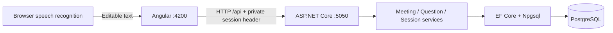
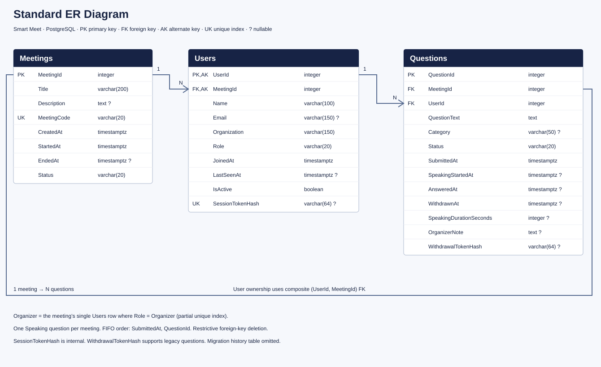

# CAPS.ai Meetings Organizer

## Project name and folder

The source project is **CAPS_ai**; the visible application name is **CAPS.ai Meetings Organizer**.

```text
CAPS_ai/
├── CAPS_ai.slnx
├── CAPS_ai.API/
│   ├── CAPS_ai.API.csproj
│   └── Data/CAPS_aiDbContext.cs
├── CAPS_ai-frontend/
└── checks/CAPS_ai.Checks.csproj
```

Open the **CAPS_ai** folder in VS Code. Run `dotnet run --project CAPS_ai.API` from this folder; in another terminal, run `npm start` inside `CAPS_ai-frontend`.

npm/Angular use the normalized package/workspace name `caps-ai` because their naming conventions differ from C# project names. The PostgreSQL database/connection key `SmartMeetDB`, local user-secrets ID, and existing `smartMeet.*` browser-storage keys are intentionally retained so the rename does not lose data, custom credentials, organizer sessions, or withdrawal keys. No schema migration is required for this project rename.

**Existing local database:** its EF history table was deliberately removed previously. Normal app startup works without it. Do not run `dotnet ef database update` on that existing database until the matching migration-history backup is restored and the applied schema is checked. This rename does not restore or recreate the history table.

A full-stack assignment for managing meeting questions, participants, and speaking order. Built with **Angular 22**, **ASP.NET Core 10**, **Entity Framework Core**, and **PostgreSQL 16+**.

## Features

| Organizer | Visitor |
|---|---|
| Create a meeting with organizer name, organization, title, and description | Join with name, organization, and optional email |
| View meeting code, start time, elapsed duration, and visitor counts | Reuse the same private session after refresh |
| Search and filter questions by status/category | Submit questions by typing or microphone dictation |
| Select speakers in FIFO order and mark answers | Choose General, Technical, Feedback, or Other |
| Add/edit optional question notes | Withdraw only your own pending questions |
| Open a compact participant list with activity status | View the queue, current speaker, and own submissions |
| End a meeting and view its summary | Review recognized text before explicitly submitting |

The database has **Meeting, MeetingAttendees, and MeetingQuestions**, plus EF Core migration history. Upvoting and announcements have been removed. Meetings and questions from older versions are preserved.

## Architecture



Organizer and visitor operations use server-issued random session tokens. The API validates the token and derives the user, meeting, and role; submitting a UserId or changing the Angular URL grants no permissions. Only token hashes are stored in PostgreSQL. There are no passwords, registration pages, or JWTs.

## Meeting invitations and compact dashboard

The dashboard header shows the actual meeting title, organizer, date, status, code, counts, and duration. Search and filters stay above an independently scrolling queue; the desktop organizer keeps three panels.

New meeting codes use `abc-defg-hij` format. The backend generates them securely, enforces uniqueness in PostgreSQL (including case-insensitive uniqueness), and retries rare insert collisions. Existing hexadecimal/LEGACY codes stay unchanged and remain valid.

- Home: enter a code in **Join a meeting**.
- Invitation: `/join/abc-defg-hij` resolves the meeting and opens registration.
- Already joined visitors reuse their validated session and enter the visitor dashboard.
- Numeric `/meeting/:id/visitor` links still work.
- **Copy Code**, **Copy Invite Link**, and **Show QR** are beside the code.
- The QR modal generates its PNG in the browser with the lazy-loaded [qrcode library](https://github.com/soldair/node-qrcode); no QR images are stored in PostgreSQL. It supports copy and download with a four-module quiet zone.

### Phone and deployed invitation addresses

Edit `CAPS_ai-frontend/src/app/app-settings.ts`:

```typescript
export const APP_SETTINGS = { publicApplicationBaseUrl: 'http://192.168.1.20:4200' };
```

Use your Mac's actual LAN address or deployed HTTPS domain. Leave it empty to use the current browser origin. Do not put tokens, credentials, or query strings in this address.

For LAN testing, run Angular with `npm start -- --host 0.0.0.0` and allow the dev-server port through your host firewall if prompted. The Angular proxy still connects to the local API. Both devices must be on a reachable network. A phone's localhost refers to the phone, not the Mac. The QR modal warns when the generated address is local-only. Voice recognition on hosted/network pages requires an appropriate secure browser context; use HTTPS for deployed use.

## Complete meeting summary

Ended meeting cards and **View Summary** open `/meeting/:id/summary`. The page includes meeting details, registered visitor count, question status counts, total/average completed speaking duration, participant snapshot, a status-filtered question table with notes, and a chronological timeline derived from saved timestamps.

Detailed summaries require the meeting's organizer session. Use the original browser/origin; no organizer token is added to invitation URLs. Old meetings with no recoverable organizer remain readable via the dashboard, without exposing organizer-only summary data. Registered visitors exclude the organizer and unclaimed legacy attendee rows. Duration averages include answered questions with a stored duration, including zero; missing times are shown as unavailable. No synthetic timeline events or separate event-log table are added.

## Setup

Requirements: .NET 10 SDK, Node.js 24 with npm, PostgreSQL 16+, and Git.

```bash
git clone https://github.com/abhiilekhborah/Smart-Meeting-Origanizer.git CAPS_ai
cd CAPS_ai
```

On macOS with Homebrew:

```bash
brew install postgresql@16
brew services start postgresql@16
export PATH="$(brew --prefix postgresql@16)/bin:$PATH"
pg_isready -h localhost -p 5432
```

The default local connection is `Host=localhost;Port=5432;Database=SmartMeetDB;Timeout=5`, using the current OS username. For a custom role/password, set local configuration without committing credentials:

```bash
dotnet user-secrets set 'ConnectionStrings:SmartMeetDB' 'Host=localhost;Port=5432;Database=SmartMeetDB;Username=YOUR_ROLE;Password=YOUR_PASSWORD;Timeout=5' --project CAPS_ai.API
```

### Existing installation: back up before migrating

The restructuring migration **permanently drops QuestionVotes and Announcements, including their data**. It preserves meetings, questions, participant details, timestamps, and legacy withdrawal hashes. Read [the migration guide](docs/MIGRATION.md) before applying it to an existing database.

```bash
mkdir -p backups
pg_dump -h localhost -d SmartMeetDB -Fc -f backups/before-user-restructure.dump
pg_restore --list backups/before-user-restructure.dump
```

### Backend

From the repository root:

```bash
dotnet restore CAPS_ai.slnx
dotnet tool restore
dotnet ef database update --project CAPS_ai.API
dotnet run --project CAPS_ai.API
```

The PostgreSQL role needs permission to create the database, or an administrator must create it first. Migrations are a separate step and do not run automatically at API startup.

- [Swagger](http://localhost:5050/swagger)
- [Meetings API](http://localhost:5050/api/meetings)

### Frontend

In another terminal, from the repository root:

```bash
cd CAPS_ai-frontend
npm ci
npm start
```

Open [http://localhost:4200](http://localhost:4200). The development proxy forwards `/api` to port 5050. Keep PostgreSQL and both servers running.

## Workflow

1. Create a meeting and enter the organizer's name and organization. The browser receives its private organizer session.
2. Copy the visitor invite link and open it in another tab or browser. A localhost link is usable on the same computer.
3. Join as a visitor. Identical names are allowed; each new session represents a separate participant.
4. Submit questions, optionally using **Speak question** and a category.
5. As organizer, pick the next question and mark it answered. Add a note if needed.
6. Open **Participants** to review joined users. Active visitors have sent activity within the last 60 seconds.
7. End the meeting to close joining/submissions and display the summary.

Active dashboards poll every four seconds and heartbeat their current session. Closing a tab does not imply immediate disconnection. Participant counts are derived from Meeting Attendees; unclaimed historical participant records are listed separately and excluded from registered visitor totals.

### Queue and history

- Pending questions are selected by `SubmittedAt`, then `QuestionId`; categories and filters do not reorder the queue.
- Transactions, meeting-row locks, and a partial unique index enforce one current speaker.
- Answering records a completed speaking duration in whole seconds.
- Ending returns the current speaking question to Pending and clears its speaking start; it does not count it as answered.
- Old meetings remain readable. Their organizer name is shown as not recorded; nobody can claim them by entering a matching name.
- Each old question receives an unclaimed historical User row. Its original withdrawal token remains valid only for that question. It cannot claim the User account.

### Sessions and voice

Sessions are stored per meeting and role in browser storage. Keep the same browser and origin: `localhost` and `127.0.0.1` have separate storage. Lost organizer tokens have no password-recovery flow in this basic version. If storage is blocked, tokens remain usable only for the current page session.

Voice input uses the browser speech recognizer with one English setting and no language dropdown. Stop dictation, review the text, and explicitly submit. The browser may use an online speech service; Smart Meet stores text, not audio. Try Chrome if Brave reports a speech-service connection error. Localhost supports development microphone access; hosted use needs HTTPS.

## Code layout

```text
CAPS_ai.API/
  Controllers/      Meetings, questions, and users HTTP endpoints
  Services/         Meeting/session ownership, FIFO rules, summaries, token hashing
  Models/           User, Meeting, Question
  DTOs/             Validated requests and public response contracts
  Data/             DbContext, relationships, indexes, constraints
  Migrations/       Original migrations plus preserving three-table restructuring
CAPS_ai-frontend/
  src/app/components/  Home, create/join forms, dashboard, queue, speaker, voice, summary
  src/app/services/    HTTP clients, session storage, dictation controller, filters
  src/app/models/      TypeScript API types
```

Most Angular HTML templates are inside `.component.ts` files. See [CODEBASE_REPORT.md](CODEBASE_REPORT.md) for the file-by-file guide.

## Database diagrams

[Standard ER diagram and SSMS-style schema diagram](docs/DATABASE_DIAGRAMS.md), with SVG files and editable Mermaid source. The second is a PostgreSQL diagram drawn in SSMS style, not an SSMS export.



## Build checks

From the repository root:

```bash
dotnet build CAPS_ai.slnx
dotnet test checks/CAPS_ai.Checks.csproj
```

From `CAPS_ai-frontend/`:

```bash
npm run build
npm run check
```

Focused checks now live under `checks/` and `CAPS_ai-frontend/checks/`; the previously archived voice/FIFO checks have been restored there. See the check commands below.

## Scope

This is a basic assignment with anonymous capability sessions, not a full account system. A copied token grants its session's capabilities; use HTTPS in any hosted environment and keep tokens private. Public meeting/question reads remain available; detailed summaries require the associated organizer session. Participant emails and participant listing require the organizer session. There are no live audio/video calls, recorded answers, or WebSocket updates.

## Routes

| Route | Purpose |
|---|---|
| `/` | Create/list meetings; join with a code |
| `/join/:code` | Code-based lookup, registration, or existing-session redirect |
| `/meeting/:id/organizer` | Organizer dashboard |
| `/meeting/:id/visitor` | Visitor dashboard and compatible numeric joining |
| `/meeting/:id/summary` | Organizer-only complete ended-meeting snapshot |

API additions: `GET /api/meetings/by-code/{code}` and `POST /api/meetings/by-code/{code}/join`. Both joining routes share SessionService.Join. `GET /api/meetings/{id}/summary` now returns the complete snapshot and requires the organizer's bearer session.

## Table rename migration

`20261026152129_RenameMeetingTables` maps the unchanged C# entities to Meeting, MeetingAttendees (display name Meeting Attendees), and MeetingQuestions. It renames tables, indexes, and constraints without deleting data, and adds case-insensitive code uniqueness. [Read the rename/backup guide](docs/RENAME_MIGRATION.md) before applying it. Keep EF migration history; deleting it prevents safe detection of applied migrations.

## Documentation

- [VS Code startup and database queries](START_HERE.md)
- [Codebase report](CODEBASE_REPORT.md)
- [Migration safety, backup, and verification](docs/MIGRATION.md)
- [Database diagrams](docs/DATABASE_DIAGRAMS.md)
