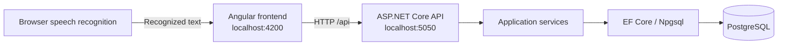

# Smart Meeting Origanizer

A full-stack assignment for managing participant questions during meetings. Organizers manage a FIFO queue and the current speaker; visitors submit questions by typing or voice.

Built with **Angular 22**, **ASP.NET Core 10**, **Entity Framework Core**, and **PostgreSQL**. The application runs locally on macOS, including Apple Silicon.

## Features

| Organizer | Visitor |
|---|---|
| Create meetings and copy visitor invite links | Submit a question with name and organization |
| Search questions and filter by status | Dictate a question using the microphone |
| Pick the next question in FIFO order | Review and edit recognized text before submitting |
| View the current speaker and elapsed speaking time | View the pending queue and current speaker |
| Mark the current question as answered | Upvote questions without changing queue order |
| Publish announcements | Withdraw an owned pending question |
| End meetings and view a summary | View announcements and browser-specific submission history |

Records persist in PostgreSQL. Active dashboards refresh every four seconds. Speaking time is calculated from a saved timestamp, so refreshing the page preserves elapsed time.

## Architecture



The Angular development server proxies `/api` requests to the backend. Controllers receive requests, services apply meeting rules, and Entity Framework Core reads and writes PostgreSQL records.

## Requirements

- .NET 10 SDK
- Node.js 24 and npm
- PostgreSQL 16 or newer
- Git
- Python 3 only for the optional integration checks
- A browser with speech recognition support for voice input; Google Chrome is the suggested option for this project

## Getting started

### 1. Clone the repository

```bash
git clone https://github.com/abhiilekhborah/Smart-Meeting-Origanizer.git
cd Smart-Meeting-Origanizer
```

Open this folder in VS Code. Use separate terminals for the backend and frontend.

### 2. Start PostgreSQL

For a Homebrew installation on macOS:

```bash
brew install postgresql@16
brew services start postgresql@16
export PATH="$(brew --prefix postgresql@16)/bin:$PATH"
pg_isready -h localhost -p 5432
```

If PostgreSQL is already installed, start your existing service. Other operating systems can use an existing local PostgreSQL installation.

The checked-in development connection string contains no password:

```text
Host=localhost;Port=5432;Database=SmartMeetDB;Timeout=5
```

It uses the current operating-system username. If your database requires a different role or password, configure it locally using .NET user secrets:

```bash
dotnet user-secrets set 'ConnectionStrings:SmartMeetDB' 'Host=localhost;Port=5432;Database=SmartMeetDB;Username=YOUR_ROLE;Password=YOUR_PASSWORD;Timeout=5' --project SmartMeet.API
```

Use your own credentials in your terminal; keep them out of committed files. User secrets are loaded in the Development environment used by the launch profile. Your PostgreSQL role must be able to create `SmartMeetDB`, or that database must already exist and be owned by a suitable role.

### 3. Restore and apply database migrations

From the repository root:

```bash
dotnet restore SmartMeet.slnx
dotnet tool restore
dotnet ef database update --project SmartMeet.API
```

This applies the committed migrations and creates the schema. Re-running the update checks for pending migrations; it does not reset existing records. Migrations are not applied automatically when the API starts.

### 4. Start the backend

```bash
dotnet run --project SmartMeet.API
```

- API: [http://localhost:5050/api/meetings](http://localhost:5050/api/meetings)
- Swagger: [http://localhost:5050/swagger](http://localhost:5050/swagger)

Keep this terminal running.

### 5. Start the frontend

In another terminal, from the repository root:

```bash
cd smart-meet-frontend
npm ci
npm start
```

Open [http://localhost:4200](http://localhost:4200). Both servers and PostgreSQL must be running.

## Using the application

1. Create a meeting from the home page.
2. In the organizer dashboard, copy the invite link and open it in another tab.
3. In visitor view, enter a name, organization, and question, then submit.
4. In organizer view, click **Pick next question** to select the earliest pending question.
5. Click **Mark as answered** when that question is complete, then select the next question.
6. Publish announcements or use search and status filters as needed.
7. Click **End meeting** to close participation and view the summary.

The organizer dashboard has management controls. The question-submission form appears in the visitor dashboard.

### Voice input

Click **Speak question**, allow microphone access, speak, and click **Stop dictation**. Review the text before submitting. The application uses one English setting with no language dropdown.

Speech recognition depends on the browser and may need an online speech service. Brave may expose the speech API but fail to connect; try the same visitor URL in Chrome. Typing remains available. Localhost supports development microphone use; a hosted version would need HTTPS. Smart Meet stores submitted text, not audio recordings.

## Queue and participation rules

- **FIFO:** Pending questions are ordered by submission time, then question ID. Votes and search filters do not change selection order.
- **One speaker:** Transactions, a meeting-row lock, and a database index protect against simultaneous speaker selection.
- **Question states:** `Pending → Speaking → Answered`, or `Pending → Withdrawn`.
- **Ending:** The current speaking question returns to `Pending`; only explicitly answered questions count as answered. Records remain available.
- **Voting:** A browser token identifies votes. A unique database index prevents duplicate votes for the same question/token pair.
- **Withdrawal:** A private token returned at submission allows the same browser to withdraw its pending question. The database stores its hash.
- **Browser storage:** Visitor identity, vote indicators, and withdrawal keys use local storage. Clearing storage can remove these capabilities. `localhost` and `127.0.0.1` use separate browser storage.

## Project structure

```text
.
├── SmartMeet.API/                  ASP.NET Core backend
│   ├── Controllers/              HTTP routes
│   ├── DTOs/                     Request validation and response contracts
│   ├── Models/                   Meeting, Question, QuestionVote, Announcement
│   ├── Services/                 Meeting logic, FIFO rules, tokens, summaries
│   ├── Data/                     EF Core database configuration
│   ├── Migrations/               Versioned PostgreSQL schema changes
│   └── Program.cs                Startup, dependency injection, error handling
├── smart-meet-frontend/            Angular application
│   ├── src/app/components/       Pages, forms, queue, speaker, voice, summaries
│   ├── src/app/services/         API clients, visitor session, dictation, filters
│   ├── src/app/models/           TypeScript data contracts
│   └── tests/                    Dictation and filtering unit tests
├── SmartMeet.Tests/               Backend unit tests and API integration scripts
├── .config/dotnet-tools.json       Pinned EF Core CLI tool
├── SmartMeet.slnx                 .NET solution
├── CODEBASE_REPORT.md             File-by-file explanation and request flows
└── START_HERE.md                  VS Code startup and database inspection guide
```

Most Angular components contain their HTML templates inside their `.component.ts` files. For a detailed explanation of every main file, read [the codebase report](CODEBASE_REPORT.md).

## Database

| Table | Stores |
|---|---|
| `Meetings` | Titles, status, creation time, and end time |
| `Questions` | Participants, question text, lifecycle timestamps, and withdrawal-token hashes |
| `QuestionVotes` | Question references and visitor-token hashes |
| `Announcements` | Meeting announcements and timestamps |
| `__EFMigrationsHistory` | Applied EF Core migrations |

One meeting has many questions and announcements; one question has many votes.

To inspect the database:

```bash
psql -h localhost -p 5432 -d SmartMeetDB
```

Inside `psql`:

```sql
-- List tables: use the psql command \dt
SELECT * FROM "Meetings" ORDER BY "MeetingId";
SELECT "QuestionId", "Name", "QuestionText", "Status"
FROM "Questions" ORDER BY "SubmittedAt", "QuestionId";
SELECT * FROM "Announcements" ORDER BY "CreatedAt" DESC;
SELECT * FROM "__EFMigrationsHistory" ORDER BY "MigrationId";
```

Use `\q` to exit. Keep the double quotes around the mixed-case table and column names. More queries are available in [START_HERE.md](START_HERE.md).

Schema changes live in `SmartMeet.API/Migrations/`. Their filenames use `YYYYMMDDHHmmss_Description.cs`; `Up()` applies changes and `Down()` reverses them.

## Builds and tests

From the repository root:

```bash
dotnet build SmartMeet.slnx
dotnet test SmartMeet.Tests/SmartMeet.Tests.csproj
```

From `smart-meet-frontend/`:

```bash
npm run build
npm test
```

Backend unit tests cover FIFO, state transitions, token handling, and summaries. Frontend unit tests cover dictation lifecycle/errors and search/status filtering.

Optional integration checks require the API and PostgreSQL to be running. From the repository root:

```bash
python3 SmartMeet.Tests/api_smoke.py
python3 SmartMeet.Tests/feature_smoke.py
```

These integration scripts create and retain test records in the connected database.

## Troubleshooting

| Problem | Check |
|---|---|
| `dotnet` or `npm` is unavailable | Install the required SDK/runtime and reopen the terminal. |
| Database connection fails | Start PostgreSQL and check the role, connection string, and port 5432. |
| A database table is missing | Apply migrations using the same connection settings as the API. |
| Frontend cannot reach the API | Confirm the API is listening on 5050 and the frontend proxy is enabled. |
| Port 4200 or 5050 is occupied | Stop the previous server in its terminal before starting another instance. |
| Voice input fails | Check microphone permissions and try Chrome; the speech service may require internet access. |
| Withdrawal is unavailable | Use the submitting browser and origin; the private token may have been removed with browser storage. |

## Assignment scope

This is an academic application. Organizer routes and API actions have no login-based authorization; the organizer/visitor view switch is not access control. Browser-token voting does not enforce one vote per verified person. Add authentication and role authorization before deploying to a shared environment.

The project manages questions and speaker timing. It does not include video conferencing, live audio calls, recorded answers, email delivery, or WebSocket updates.

## Documentation

- [Startup and PostgreSQL guide](START_HERE.md)
- [Codebase report: folders, files, and workflows](CODEBASE_REPORT.md)
- [Interactive API documentation](http://localhost:5050/swagger) — available while the development API is running
