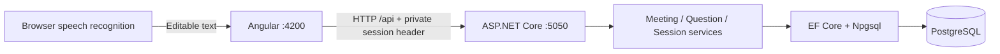

# Smart Meeting Origanizer

A full-stack assignment for managing meeting questions, participants, and speaking order. Built with **Angular 22**, **ASP.NET Core 10**, **Entity Framework Core**, and **PostgreSQL 16+**.

## Features

| Organizer | Visitor |
|---|---|
| Create a meeting with organizer name, organization, title, and description | Join with name, organization, and optional email |
| View meeting code, start time, elapsed duration, and visitor counts | Reuse the same private session after refresh |
| Search and filter questions by status/category | Submit questions by typing or microphone dictation |
| Select speakers in FIFO order and mark answers | Choose General, Technical, Feedback, or Other |
| Add/edit optional question notes | Withdraw only your own pending questions |
| Open a compact participant list with activity status | View the queue, current speaker, and own submissions |
| End a meeting and view its summary | Review recognized text before explicitly submitting |

The database has **Users, Meetings, and Questions**, plus EF Core migration history. Upvoting and announcements have been removed. Meetings and questions from older versions are preserved.

## Architecture



Organizer and visitor operations use server-issued random session tokens. The API validates the token and derives the user, meeting, and role; submitting a UserId or changing the Angular URL grants no permissions. Only token hashes are stored in PostgreSQL. There are no passwords, registration pages, or JWTs.

## Setup

Requirements: .NET 10 SDK, Node.js 24 with npm, PostgreSQL 16+, and Git.

```bash
git clone https://github.com/abhiilekhborah/Smart-Meeting-Origanizer.git
cd Smart-Meeting-Origanizer
```

On macOS with Homebrew:

```bash
brew install postgresql@16
brew services start postgresql@16
export PATH="$(brew --prefix postgresql@16)/bin:$PATH"
pg_isready -h localhost -p 5432
```

The default local connection is `Host=localhost;Port=5432;Database=SmartMeetDB;Timeout=5`, using the current OS username. For a custom role/password, set local configuration without committing credentials:

```bash
dotnet user-secrets set 'ConnectionStrings:SmartMeetDB' 'Host=localhost;Port=5432;Database=SmartMeetDB;Username=YOUR_ROLE;Password=YOUR_PASSWORD;Timeout=5' --project SmartMeet.API
```

### Existing installation: back up before migrating

The restructuring migration **permanently drops QuestionVotes and Announcements, including their data**. It preserves meetings, questions, participant details, timestamps, and legacy withdrawal hashes. Read [the migration guide](docs/MIGRATION.md) before applying it to an existing database.

```bash
mkdir -p backups
pg_dump -h localhost -d SmartMeetDB -Fc -f backups/before-user-restructure.dump
pg_restore --list backups/before-user-restructure.dump
```

### Backend

From the repository root:

```bash
dotnet restore SmartMeet.slnx
dotnet tool restore
dotnet ef database update --project SmartMeet.API
dotnet run --project SmartMeet.API
```

The PostgreSQL role needs permission to create the database, or an administrator must create it first. Migrations are a separate step and do not run automatically at API startup.

- [Swagger](http://localhost:5050/swagger)
- [Meetings API](http://localhost:5050/api/meetings)

### Frontend

In another terminal, from the repository root:

```bash
cd smart-meet-frontend
npm ci
npm start
```

Open [http://localhost:4200](http://localhost:4200). The development proxy forwards `/api` to port 5050. Keep PostgreSQL and both servers running.

## Workflow

1. Create a meeting and enter the organizer's name and organization. The browser receives its private organizer session.
2. Copy the visitor invite link and open it in another tab or browser. A localhost link is usable on the same computer.
3. Join as a visitor. Identical names are allowed; each new session represents a separate participant.
4. Submit questions, optionally using **Speak question** and a category.
5. As organizer, pick the next question and mark it answered. Add a note if needed.
6. Open **Participants** to review joined users. Active visitors have sent activity within the last 60 seconds.
7. End the meeting to close joining/submissions and display the summary.

Active dashboards poll every four seconds and heartbeat their current session. Closing a tab does not imply immediate disconnection. Participant counts are derived from Users; unclaimed historical participant records are listed separately and excluded from registered visitor totals.

### Queue and history

- Pending questions are selected by `SubmittedAt`, then `QuestionId`; categories and filters do not reorder the queue.
- Transactions, meeting-row locks, and a partial unique index enforce one current speaker.
- Answering records a completed speaking duration in whole seconds.
- Ending returns the current speaking question to Pending and clears its speaking start; it does not count it as answered.
- Old meetings remain readable. Their organizer name is shown as not recorded; nobody can claim them by entering a matching name.
- Each old question receives an unclaimed historical User row. Its original withdrawal token remains valid only for that question. It cannot claim the User account.

### Sessions and voice

Sessions are stored per meeting and role in browser storage. Keep the same browser and origin: `localhost` and `127.0.0.1` have separate storage. Lost organizer tokens have no password-recovery flow in this basic version. If storage is blocked, tokens remain usable only for the current page session.

Voice input uses the browser speech recognizer with one English setting and no language dropdown. Stop dictation, review the text, and explicitly submit. The browser may use an online speech service; Smart Meet stores text, not audio. Try Chrome if Brave reports a speech-service connection error. Localhost supports development microphone access; hosted use needs HTTPS.

## Code layout

```text
SmartMeet.API/
  Controllers/      Meetings, questions, and users HTTP endpoints
  Services/         Meeting/session ownership, FIFO rules, summaries, token hashing
  Models/           User, Meeting, Question
  DTOs/             Validated requests and public response contracts
  Data/             DbContext, relationships, indexes, constraints
  Migrations/       Original migrations plus preserving three-table restructuring
smart-meet-frontend/
  src/app/components/  Home, create/join forms, dashboard, queue, speaker, voice, summary
  src/app/services/    HTTP clients, session storage, dictation controller, filters
  src/app/models/      TypeScript API types
```

Most Angular HTML templates are inside `.component.ts` files. See [CODEBASE_REPORT.md](CODEBASE_REPORT.md) for the file-by-file guide.

## Database diagrams

[Standard ER diagram and SSMS-style schema diagram](docs/DATABASE_DIAGRAMS.md), with SVG files and editable Mermaid source. The second is a PostgreSQL diagram drawn in SSMS style, not an SSMS export.


## Build checks

From the repository root:

```bash
dotnet build SmartMeet.slnx
```

From `smart-meet-frontend/`:

```bash
npm run build
```

Test folders and test commands have been removed from this assignment copy. Previous verification results are retained in [docs/VERIFICATION.md](docs/VERIFICATION.md).

## Scope

This is a basic assignment with anonymous capability sessions, not a full account system. A copied token grants its session's capabilities; use HTTPS in any hosted environment and keep tokens private. Public meeting/question reads remain available. Participant emails and participant listing require the organizer session. There are no live audio/video calls, recorded answers, or WebSocket updates.

## Documentation

- [VS Code startup and database queries](START_HERE.md)
- [Codebase report](CODEBASE_REPORT.md)
- [Migration safety, backup, and verification](docs/MIGRATION.md)
- [Database diagrams](docs/DATABASE_DIAGRAMS.md)
