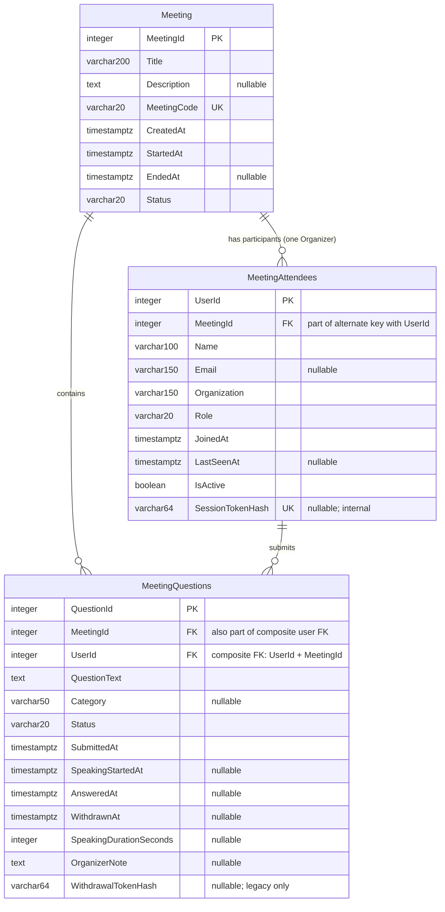
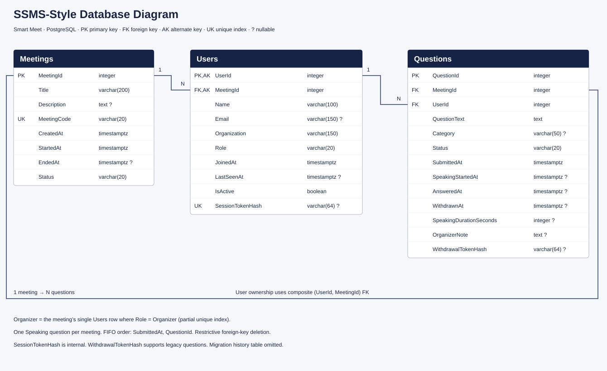

# Smart Meet database diagrams

The implemented PostgreSQL tables are **Meeting**, **MeetingAttendees**, and **MeetingQuestions**. The report/display name of MeetingAttendees is **Meeting Attendees**. C# entity names remain Meeting, User, and Question.

## Standard ER diagram

## SSMS-Style PostgreSQL Database Diagram

This table-box drawing represents PostgreSQL. It is not an authentic Microsoft SSMS export.

## Constraints and relationships

- MeetingAttendees.MeetingId → Meeting.MeetingId.
- MeetingQuestions.MeetingId → Meeting.MeetingId.
- (MeetingQuestions.UserId, MeetingQuestions.MeetingId) → the alternate unique key (MeetingAttendees.UserId, MeetingAttendees.MeetingId). This rejects cross-meeting ownership.
- All foreign keys use restricted deletion.
- At most one Organizer attendee per meeting; organizer ID is derived, not duplicated in Meeting.
- At most one Speaking question per meeting (partial unique index).
- MeetingCode has its existing unique index plus a unique expression index on lower(MeetingCode), preserving old codes while enforcing case-insensitive uniqueness. New codes use abc-defg-hij format and secure random letters.
- Non-null session-token hashes are unique; raw session tokens are never stored.
- Category is General, Technical, Feedback, Other, or NULL for compatibility; API defaults to General.
- WithdrawalTokenHash is retained only for legacy question withdrawal.
- Registered visitor counts are derived from session-backed Visitor attendees. Historical unclaimed attendees are not counted as registered visitors.
- __EFMigrationsHistory remains present as an EF system table and is omitted from the application diagrams.

The rename migration changes table/index/constraint names in place and adds the case-insensitive index. It does not recreate these tables or change their rows, codes, timestamps, or ownership.
