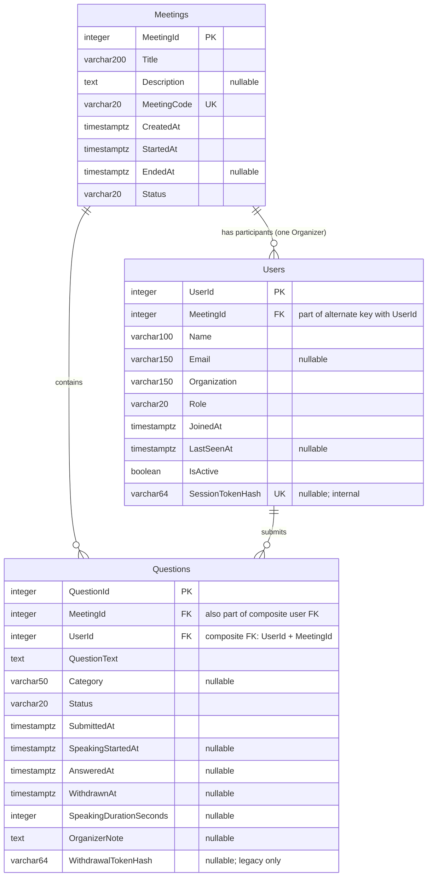

# Database diagrams

## Standard ER diagram

## SSMS-Style Database Diagram

This is a PostgreSQL schema drawn in an SSMS-style table-box layout, not an actual SSMS export.

## Relationship and legacy decisions

- `Users.MeetingId` references `Meetings.MeetingId` with restricted deletion.
- `Questions.MeetingId` references `Meetings.MeetingId` with restricted deletion.
- `(Questions.UserId, Questions.MeetingId)` references the alternate key `(Users.UserId, Users.MeetingId)`. This prevents cross-meeting ownership at database level.
- The organizer is the single user with `Role = 'Organizer'` in that meeting. A partial unique index enforces at most one. Meeting creation transactionally inserts both records. `OrganizerId` is returned in API responses, not duplicated as a stored column; this avoids a circular foreign key.
- Historical meetings have no invented organizer. Every historical question has its own unclaimed Visitor record; identical names are not merged.
- `SessionTokenHash` is null only for unclaimed historical users. Their question-specific withdrawal hashes are retained. New questions use session ownership and leave `WithdrawalTokenHash` null.
- Registered/active visitor counts are derived from session-backed Visitor rows. Historical unclaimed rows appear separately in participant listings and do not inflate joined visitor counts.
- `TotalParticipants` is calculated, not stored. `IsActive` is effective only when the meeting is active and `LastSeenAt` is within 60 seconds; a stale stored flag alone does not count as active.
- Question states: Pending, Speaking, Answered, Withdrawn. Categories: General, Technical, Feedback, Other; API defaults to General.
- `IX_OneSpeakerPerMeeting` permits at most one Speaking question per meeting.
- `__EFMigrationsHistory` is the only additional system table and is omitted here.
